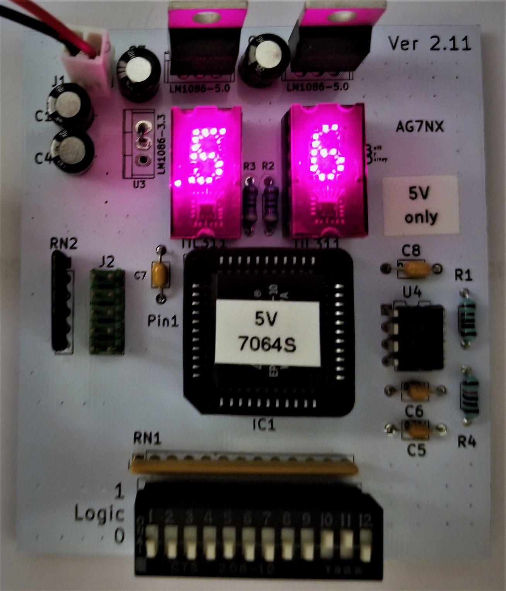
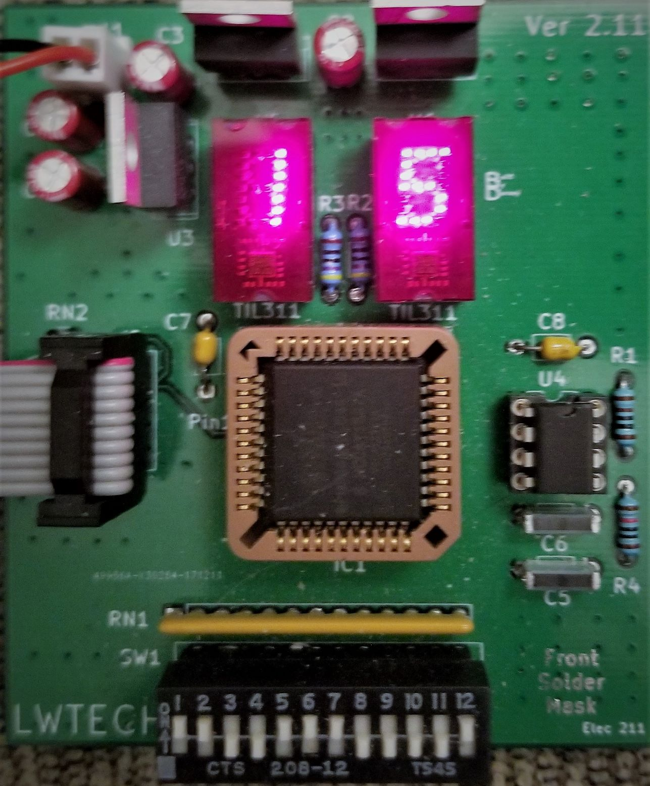
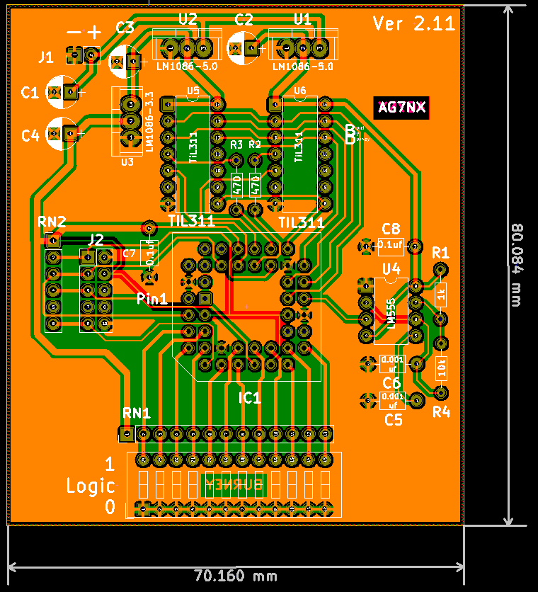
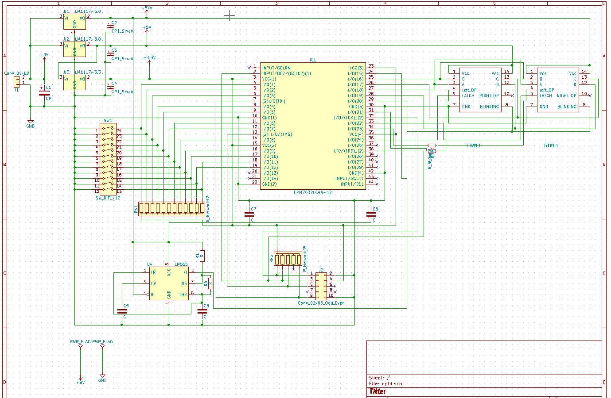

> **Archived — final / last release.** This project is complete and frozen. Issues and PRs are not expected; the tree is the historical record.

# CPLD Development System

[](https://github.com/K9DTV/cpld-development-system)
[](LICENSE)
[](https://github.com/K9DTV/cpld-development-system#quartus-project-calulator)
[](https://github.com/K9DTV/cpld-development-system#quartus-project-calulator)
[](https://github.com/K9DTV/cpld-development-system#kicad--fabrication-pcb-files)
[](https://github.com/K9DTV/cpld-development-system#quartus-project-calulator)

A hand-designed Altera MAX 7000AE/S CPLD development board and the digital labs built on it — from Lake Washington Institute of Technology **Electronics 211** (2017–2018), by **James Burney (K9DTV)**.

This repository packs the PCB design, fabrication outputs, board photos, project write-ups, and a Quartus calculator experiment that targeted the board.

<p align="center">
  
  &nbsp;
  
</p>

<p align="center"><em>Left (white / Ver2): board pictured with the <strong>MAX 7000S</strong> <strong>5&nbsp;V</strong> CPLD setup. Right (green): Ver1-style build.</em></p>

## What this board is

The goal was a durable **printed** CPLD trainer for the same class work that started on a hand-wired prototype: DIP switches in, dual hexadecimal TIL311-style displays out, on-board clock, and a standard JTAG/ByteBlaster programming header.

Two PCB revisions shipped:

| Version | How to spot it | Notes |
|--------|----------------|--------|
| **Ver1** | No silkscreen | Used for most lab examples in the docs |
| **Ver2** | Has silkscreen | Three display-control pins remapped (see pin table below) |

Power: about **6.5 V–12 V** input (prefer the low end; regulators get hot). Current-limit around **160 mA** when using a bench supply. Drive each display **decimal point with an open-drain** buffer so the DP turns fully off.

### MAX 7000S (5 V) vs MAX 7000AE (3.3 V)

Same PLCC-44 socket and the same lab/pin idea. The difference is supply voltage / family:

| Family | Example parts | Core / I/O | Notes |
|--------|---------------|------------|--------|
| **MAX 7000S** | EPM7032, **EPM7064S** | **5 V** | White board photo; use `Calculator-full-5v` |
| **MAX 7000AE** | EPM7032AE, **EPM7064AE** | **3.3 V** | Use `Calculator-full-3v3` |

Same calculator logic / pinout in both folders — pick the build that matches the CPLD voltage on the board. Do not mix a 5 V part with a 3.3 V rail (or the reverse) without checking VCCIO/VCCINT wiring.

Supported CPLDs (PLCC-44):

- **EPM7032** / **EPM7032AE** (32 macrocells) — display/switch / board-test labs  
- **EPM7064S** (64 MC, **5 V**) — full calculator (`calulator/Calculator-full-5v/`)  
- **EPM7064AE** (64 MC, **3.3 V**) — full calculator (`calulator/Calculator-full-3v3/`)

## Repository layout

```
.
├── README.md
├── cpld-white.jpg / cpld-green.jpg   # Assembled boards
├── cpld-pcb.png / cpld-sch.png       # Layout / schematic views
├── PCB-files/
│   ├── cpld/                         # KiCad schematic + PCB (legacy KiCad 4 era)
│   └── CLPD-grb/                     # Gerbers + drill for fab
├── calulator/                        # Quartus II projects (folder spelling preserved)
│   ├── Calculator-full-5v/           # Full calculator — EPM7064S / 5 V
│   ├── Calculator-full-3v3/          # Full calculator — EPM7064AE / 3.3 V
│   ├── board test/                   # Board bring-up
│   ├── board-test-2/                 # Switch / display exercise (32 MC)
│   └── boardtest3/                   # Follow-on board test (uses board-test-2 BDFs)
├── project docs/                     # Word write-ups (board build, PCB, counter, finals)
└── homework/                         # Class notes (ELEC 211 Ch. 4)
```

Folder and filename spellings (`calulator`, `CLPD-grb`, spaces in `project docs`) match the original archive on purpose.

## Hardware pin map

DIP switches are active-low (closed = logic 0). Most designs invert them in the CPLD so “switch ON” reads as a 1 in the logic.

| Function | Ver1 CPLD pin | Ver2 CPLD pin |
|----------|---------------|---------------|
| DIP SW 1–12 | 4, 5, 6, 8, 9, 12, 11, 14, 16, 17, 19, 18 | same |
| Clock (~66.6 kHz from 555) | 24 | 24 |
| Display A / B / C / D | 27 / 25 / 26 / 28 | same |
| Display Blank | 29 | 29 |
| Right Latch | **31** | **33** |
| Left Latch | **33** | **36** |
| Right DP | 34 | 34 |
| Left DP | **36** | **31** |

Programming-header pins follow the usual Altera JTAG layout (not duplicated in the table).

### Major bill of materials (either revision)

| Ref | Part | Notes |
|-----|------|--------|
| IC1 | EPM7032 / EPM7064S (5 V) or EPM7064AE (3.3 V), PLCC-44 | 64 MC for full calculator |
| U1–U2 | LM1117-5.0 | 5 V rails |
| U3 | LM1117-3.3 | CPLD I/O / core as wired |
| U4 | LM555 | ~66.6 kHz board clock |
| U5–U6 | TIL311 (or DIS1417) | Hex displays (hard to source; eBay) |
| SW1 | 12-position DIP slide | Active-low inputs |
| RN1 / RN2 | 10 kΩ SIP arrays | Pull-ups |
| J2 | 2×5 header | Programming |

Full Digi-Key / Mouser part numbers are in `project docs/pcb document and cpld project.docx`.

## Labs and example designs

Documented in `project docs/`:

1. **Board bring-up** — display blank/latch behavior, 555 clock divider blinking both DPs (~1 Hz after ÷65536).  
2. **Priority encoder** — exercises all DIP switches into the hex displays (BCD).  
3. **Calculator** (needs **64 MC** device) — mode select on SW11/SW12:
   - SW11=0, SW12=0 → **min/max** (7485-style compare; DPs show a swap)
   - SW11=0, SW12=1 → **add**
   - SW11=1, SW12=1 → **subtract** (borrow aware)
   - SW11=1, SW12=0 → **multiply**  
   Full builds: `Calculator-full-5v/` (**EPM7064S**, 5 V) and `Calculator-full-3v3/` (**EPM7064AE**, 3.3 V).
4. **Two-digit counter** — final-style exercise on the same pinout (`two digit counter cpld project.docx`).
5. **Hand-wired prototype** — earlier 7000-series socket board used for Ch. 4 / Ch. 7 (`211 build board.docx`).

## Quartus project (`calulator/`)

Intel/Altera **Quartus II** block-diagram labs. Folder name spelling `calulator` is preserved. The calculator top entity is named **`Calculator`**.

### Full calculator (two voltage builds)

| Folder | Device | I/O standard | Fit | Use when |
|--------|--------|--------------|-----|----------|
| `Calculator-full-5v/` | **EPM7064SLC44-10** (MAX7000S) | TTL (5 V) | 60 / 64 MC | 5 V CPLD (white board photo setup) |
| `Calculator-full-3v3/` | **EPM7064AELC44-10** (MAX7000AE) | 3.3-V LVTTL | 60 / 64 MC | 3.3 V AE CPLD |

Each folder has its own `Calculator.qpf`, BDFs/BSFs, `Calculator.pof`, and reports. Ver2 display pins (latch_R=33, latch_L=36, Left_DP=31). Open the folder that matches the chip on the board.

### Board tests

| Folder | Role |
|--------|------|
| `board test/` | Bring-up (`boardtest.qpf`, `.pof` included) |
| `board-test-2/` | Switch/display lab (`board-test-2.qpf`, EPM7032AE, `.pof` included) |
| `boardtest3/` | Later board test (`test3.qpf`; BDFs referenced from `../board-test-2/`) |

Suggested tools: **Quartus II 13.0 SP1** (or 17.1 Lite) with a USB-Blaster.

## KiCad / fabrication (`PCB-files/`)

- `PCB-files/cpld/` — schematic (`.sch`), board (`.kicad_pcb`), netlist, project (KiCad 4-style `.pro`).  
- `PCB-files/CLPD-grb/` — Gerber layers (F/B Cu, mask, silk, edge cuts) and `cpld.drl`.

Open with a modern KiCad via the legacy importer, or send the Gerbers straight to a fab.

<p align="center">
  
  &nbsp;
  
</p>

## Documentation (`project docs/`)

| File | Contents |
|------|----------|
| `211 build board.docx` | Hand-wired prototype + Ch. 7 calculator path |
| `pcb document and cpld project.docx` | Ver1/Ver2 PCB, pin map, BOM, calculator labs |
| `two digit counter cpld project.docx` | Counter lab on the PCB |
| `211 PROJECT.docx` / `211 final.docx` | Course project / final write-ups |

Course context: **Lake Washington Institute of Technology**, Electronics 211, instructor **Professor Peter Welty**.

## License / provenance

MIT -- see [LICENSE](LICENSE). Personal educational hardware and reports by James Burney (K9DTV). Course homework notes in `homework/` are included as archived class material. Altera/Intel tool output remains under their respective license terms.

Site / contact: [k9dtv.com](https://k9dtv.com) · GitHub: [K9DTV](https://github.com/K9DTV)

---

*Archived from the original CPLD development-system materials (2017–2018) and published as a public K9DTV project.*
